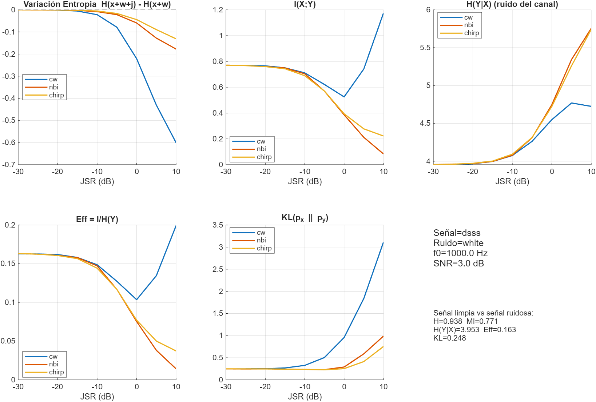
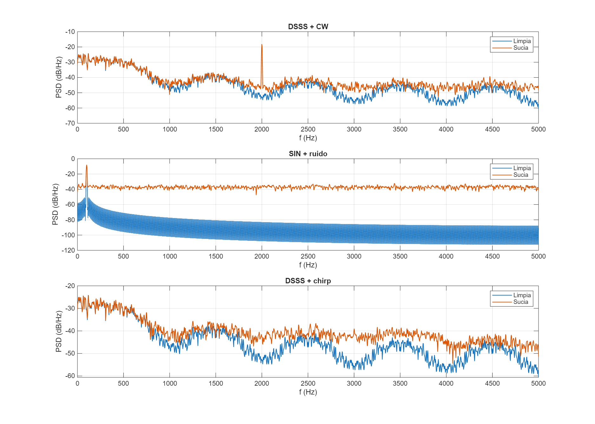
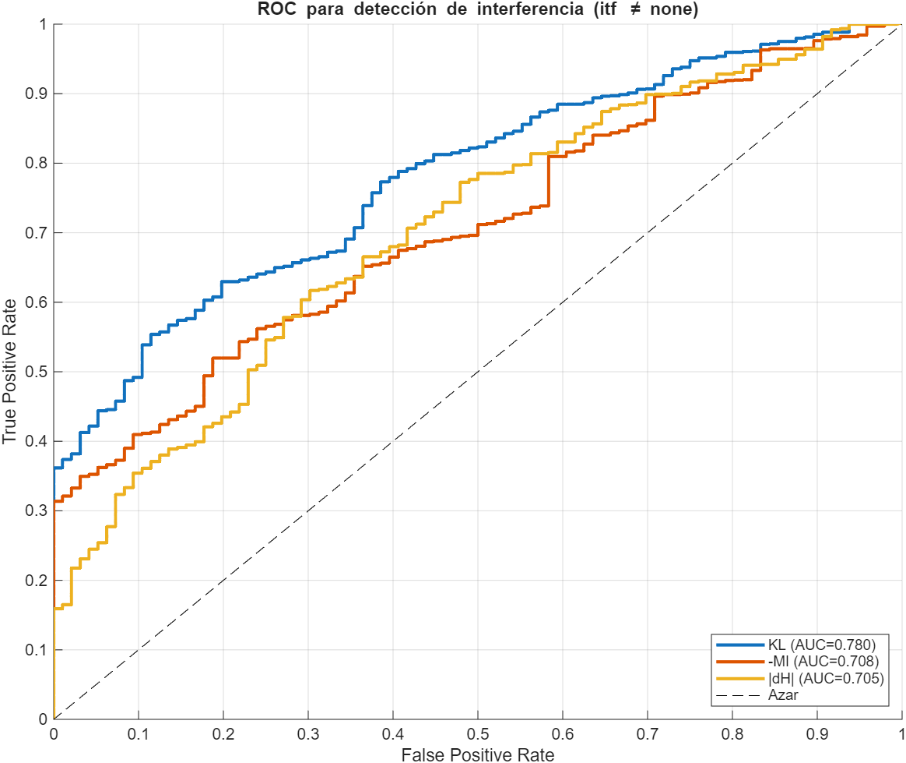

# Detecting interference in DSSS/GNSS-like signals with information theory

A MATLAB study of how well information-theoretic measures reveal interference on a signal. It covers six signal types, including a direct-sequence spread-spectrum (DSSS) signal used as a simplified GNSS model, three kinds of coloured noise and three kinds of interference. Final project for the Information Theory course of the M.Sc. in Advanced Physics (Computational Physics), UNED.

*DSSS signal with white noise (SNR = 3 dB): spectral entropy change, mutual information, channel noise H(Y|X), efficiency I/H(Y) and KL divergence as the interference power grows from −30 to +10 dB JSR, for CW, narrowband (NBI) and chirp interference.*

## What it does

1. **Signals** (`ti_signals.m`): sine, square, triangle, sawtooth, rectangular pulse train, and DSSS. The DSSS signal is a random ±1 chip sequence (chip rate R_c) modulating a carrier.
2. **Noise** (`ti_noise.m`): white, pink and brown noise, scaled to a target SNR.
3. **Interference** (`ti_interference.m`): a continuous-wave tone (CW), band-limited narrowband interference (NBI) and a linear chirp, each scaled to a target jammer-to-signal ratio (JSR).
4. **Metrics:**
   - **Spectral:** the Welch power spectral density is normalised into a probability distribution over frequency. From it the code computes the normalised Shannon entropy, the Kullback–Leibler divergence between clean and corrupted spectra, and the spectral kurtosis.
   - **Temporal:** 2D amplitude histograms of the clean and corrupted signals give the mutual information I(X;Y), the conditional entropy ("channel noise") H(Y|X), and the efficiency I(X;Y)/H(Y).
5. **Experiments:**
   - JSR sweeps for every signal × noise × interference combination.
   - DSSS at three carrier-frequency regimes.
   - An SNR–JSR grid with heatmaps and ROC curves for detecting whether interference is present.

## Results

- **Interference vs noise:** mutual information and its derived quantities fall, and the KL divergence rises, as interference grows. Changes in the noise colour, by contrast, barely move the time-domain metrics.
- **Behaviour of DSSS:** the spectral entropy of DSSS decreases under interference, unlike the harmonic signals. Its noise-like spectrum becomes more concentrated, which also raises the spectral kurtosis.
- **Detection:** over the full SNR–JSR grid, the KL divergence gives the best detection (AUC 0.78), ahead of mutual information and entropy change (AUC ≈ 0.71). The report concludes that mutual information is the most robust single indicator, because it is computed in the time domain and is barely affected by the noise colour.

## Files

| File | Purpose |
|---|---|
| `ti_signals.m`, `ti_noise.m`, `ti_interference.m` | Generator modules (each returns a struct of function handles: `generate`, `generate_all`, `plot_all`) |
| `step1_sweep_jsr_all_sig_noise.m` | JSR sweep for all signal/noise/interference combinations; figures and CSV in `outputs_seccion1/` |
| `main_freq_sweep_dsss.m` | DSSS at three carrier frequencies: metrics vs JSR, including spectral kurtosis; figures in `outputs_seccion2/` |
| `main_info_metrics.m` | Table of all metrics for every combination at fixed SNR and JSR |
| `main_sweep_metrics_and_plots.m` | SNR–JSR grid: curves, heatmaps and ROC/AUC |
| `demo_signals.m` | Plots the basic signals |

The analysis scripts were exported from MATLAB live scripts. Fs = 10 kHz throughout; the PSD uses Welch's method (typically 4096-sample windows with 50 % overlap).

## Requirements

MATLAB with the Signal Processing Toolbox (`pwelch`) and the Statistics and Machine Learning Toolbox (`kurtosis`, `perfcurve`). The DSP System Toolbox is optional: `dsp.ColoredNoise` is used when available. Run the scripts from the repository folder so the modules are on the path.

Comments and plot labels are in Spanish.
